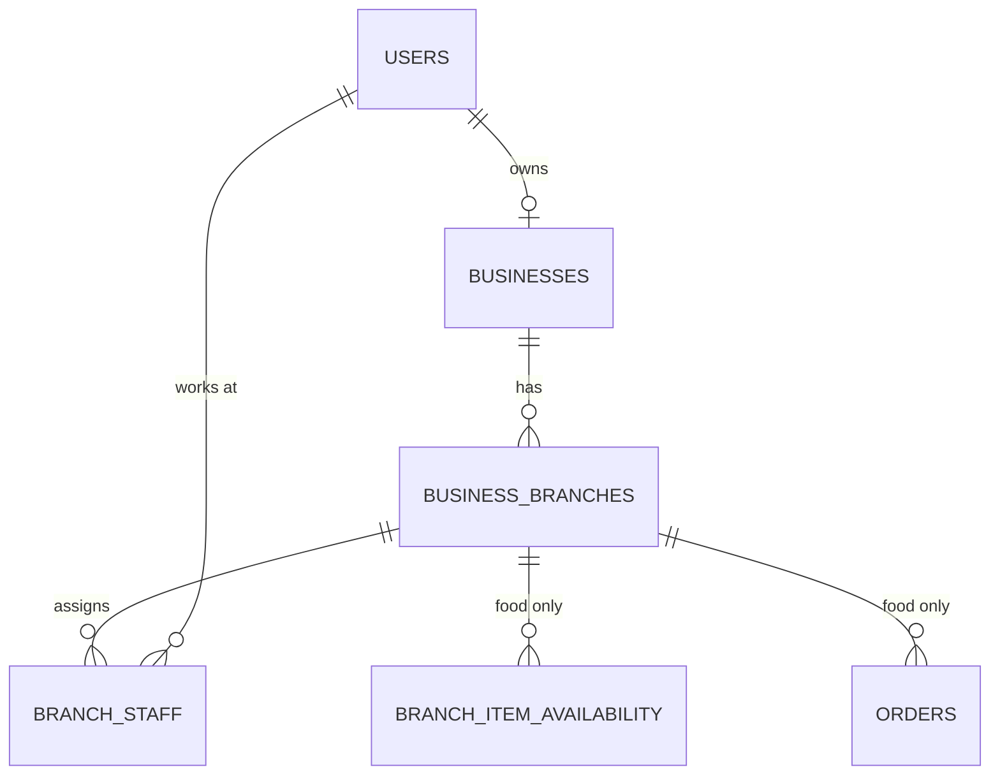

# Phase 9C — General multi-branch business management

**Baseline note.** The Phase 9B archives named in the brief were NOT supplied. This work was done on the
`pula-*-wallet-checkout` archives plus the financial-integrity slices 1-5 already made in this session (latest migration
before this phase: V47, so this phase adds **V48**). Anything that exists only in a real "Phase 9B" archive is not reflected.

## 1. Audit (from the source)
| Area | Finding |
|---|---|
| Business | One business per owner (`BusinessRepository.findByOwnerId`; `BusinessService.requireOwn`). No general staff or membership model; the only memberships are Circle roles and Business-wallet members. |
| Branch | `business_branches` (V25), JPA `BusinessBranch`: name, address, area(=suburb), lat/lon, active, temporarilyClosed, prep time, delivery fee, minimum order, hours, fulfilment options, delivery areas. Used by Food discovery, menu, checkout and `Order.branch`. |
| Branch API | Only `/api/market/food/branches` (`FoodMerchantController` -> `FoodMenuService`), gated by `requireFoodBusiness`, owner-only. Non-food businesses had no branch API at all. |
| Missing | branch code, city/province/postal code, phone/email, status beyond a boolean, verification field, manager/staff assignment, any branch-level authorisation below "owner". |
| Branch stock/prices | Only Food has per-branch availability and price overrides (`BranchItemAvailability`). Retail/wholesale products, stock and prices are business-level. |
| Branch orders | Only Food orders carry a branch (`Order.branch`), validated in `FoodCheckoutService` (rejects inactive or temporarily closed branches). |
| Public routes | `/api/businesses/*` is public (one path segment); `/api/businesses/{id}/branches/**` is two segments deeper and therefore authenticated by default. |

## 2. Before / after matrix
Status values: Implemented and tested / Partially implemented / Not implemented / Not tested.

| Feature | Before | Backend after | Web after | Mobile after | Test evidence | Remaining limitations |
|---|---|---|---|---|---|---|
| Business registration | exists, unchanged | unchanged | unchanged | unchanged | none new | no verification of any business detail |
| Parent business profile | exists | unchanged; branches reference it | link to Branches | link to Branches | none new | franchise brand/legal entity/franchisee not modelled |
| Single-branch business | works with zero branch rows | unchanged (branches optional) | empty state explains this | same | none | - |
| Multi-branch business | food only | any business type: Partially implemented | list/create | list/create | pure rules PASS; service test NOT RUN | one business per owner remains |
| Branch create / edit | food endpoint only | general API with code, address parts, contacts, hours | forms | forms | pure rules PASS; service test NOT RUN | food-only settings stay on the food API |
| Activate / suspend / close | boolean flag | `status` ACTIVE/SUSPENDED/CLOSED, one-way to CLOSED, mirrored into `active` | buttons (owner) | buttons (owner) | transition rules PASS; service test NOT RUN | closed branches cannot be reopened |
| Manager / staff assignment | none | `branch_staff`, owner assigns managers, managers assign staff | panel | panel | policy rules PASS; service test NOT RUN | multiple managers allowed; no per-task staff permissions |
| Role-based access | owner only | OWNER / MANAGER / STAFF per branch, recomputed per request | role-aware buttons | role-aware buttons | policy PASS; service test NOT RUN | no customer-facing public branch endpoint was added |
| Food branch compatibility | works | `/api/market/food/branches` unchanged; its `active` toggle now syncs `status` | unchanged | unchanged | existing food tests NOT RUN | - |
| Branch product availability | food only | unchanged | unchanged | unchanged | - | Not implemented for non-food |
| Branch inventory | none | not added | - | - | - | Not implemented (products/stock are business-level) |
| Branch pricing | food overrides | unchanged | unchanged | unchanged | - | Not implemented for non-food |
| Branch-linked orders | food only | unchanged; suspended/closed branches already rejected via `active` | - | - | not run | non-food orders have no branch |
| Branch fulfilment | food only | shown read-only on the general view | read-only | - | - | not editable via the general API (ride fee floor lives in Food) |
| Parent reporting | none | not added | - | - | - | Not implemented |
| Migrations | V47 | V48 (additive) | - | - | NOT RUN on any database | see section 6 |
| Auth / regression safety | - | all routes authenticated, relation checked per request | - | - | see section 7 | Spring/DB/E2E suites not run here |

## 3. Architecture

* **Ownership:** `businesses.owner_id` is the only source of owner rights. Owner is not stored in `branch_staff`.
* **Branch identity:** the existing `business_branches.id`; optional `branch_code`, unique per business via `uq_branch_business_code`
  (two businesses may share a code; rows without a code never collide). Codes are trimmed, upper-cased, spaces become `-`, 2-20 chars of A-Z 0-9 `-` `_`.
* **Assignments:** `branch_staff(branch_id, user_id, role MANAGER|STAFF, assigned_by)`, unique per (branch, user). A user may work at branches of
  several businesses only if each business owner assigns them; an assignment belongs to exactly one branch, hence one business.
* **Food configuration:** untouched columns/tables and endpoints. `active` is kept equal to `status == ACTIVE` (`BusinessBranch.applyStatus`; the food
  update path calls it) so Food discovery/checkout behave as before. A branch suspended or closed here cannot take food orders.
* **Not verified:** `verification_status` is always `UNVERIFIED` (CHECK-constrained). PULA performs no CIPC, ownership, address or identity verification.

## 4. Endpoints (all need a logged-in user)
| Method | Path | Who | Notes |
|---|---|---|---|
| GET | `/api/businesses/{businessId}/branches` | owner: all; manager/staff: assigned only; others 404 | |
| POST | `/api/businesses/{businessId}/branches` | owner | 201; 400 validation; 409 duplicate code |
| GET | `/api/businesses/{businessId}/branches/{branchId}` | owner, assigned manager/staff | others 404 |
| PATCH | `/api/businesses/{businessId}/branches/{branchId}` | owner, assigned manager | manager cannot change the code; closed branch 409 |
| POST | `/api/businesses/{businessId}/branches/{branchId}/status` | owner | `{"status":"SUSPENDED"}`; illegal transition 409 |
| GET | `.../{branchId}/staff` | owner, assigned manager | staff get 403 |
| POST | `.../{branchId}/staff` | owner (MANAGER or STAFF), manager (STAFF only) | `{"identifier":"a@b.com","role":"STAFF"}`; idempotent; no self-assignment; owner cannot be assigned |
| DELETE | `.../{branchId}/staff/{userId}` | owner; manager for STAFF only | 204 |
| GET | `/api/me/branch-assignments` | any user | branches the caller works at |
Retained unchanged: `GET/POST/PATCH /api/market/food/branches`, branch items.

Create example: `POST /api/businesses/biz-1/branches` `{"name":"Example Retail - Centurion","branchCode":"cen","city":"Centurion","province":"Gauteng","phone":"012 345 6789"}`
-> `201 {"id":"...","businessId":"biz-1","name":"Example Retail - Centurion","branchCode":"CEN","status":"ACTIVE","verificationStatus":"UNVERIFIED","yourRole":"OWNER",...}`.
Errors use the existing `ApiException` JSON; cross-business or unassigned access is always 404 "not found" (no existence leak), role limits are 403.

## 5. Files
Backend: `branch/{BranchStatus,BranchRole,BranchAccessPolicy,BranchRules}`, `domain/{BranchStaff,BusinessBranch}`, `repository/{BranchStaffRepository,BusinessBranchRepository}`,
`dto/BranchDtos`, `service/{BranchManagementService,FoodMenuService (status sync)}`, `controller/BranchController`, migration `V48__branch_management.sql`.
Tests: `branch/BranchAccessPolicyTest`, `branch/BranchRulesTest`, `service/BranchManagementServiceTest`.
Web: `lib/branchApi.ts`, `pages/market/{BusinessBranchesPage,BranchDetailPage}.tsx`, `App.tsx`, `SellerDashboardPage.tsx`.
Mobile: `types/branch.ts`, `services/branchApi.ts`, `app/seller/branches/index.tsx`, `app/seller/branches/[businessId]/[branchId].tsx`, `app/seller/index.tsx`.

## 6. Migration V48 (NOT RUN on H2 or PostgreSQL)
Additive columns with defaults; `status` backfilled from `active`; CHECKs for status, verification and coordinate pairs/ranges; unique index
`(business_id, branch_code)`; new `branch_staff`. Risk to verify on real data: `ck_branch_latlon` will fail if any legacy row has only one of
latitude/longitude or an out-of-range value (the Food service has always validated both, but legacy imports were not checked). Test with
`mvn -B test` (H2/Flyway) and against a PostgreSQL copy of production data before deploying.

## 7. Verification results
| Check | Result |
|---|---|
| Pure rules + policy tests (compiled with the JDK, stand-in JUnit runner): `BranchAccessPolicyTest`, `BranchRulesTest` | PASS (10) |
| Earlier ledger/refund/reconciler tests (stand-in runner) | PASS (64) |
| `BranchManagementServiceTest` (Mockito) | NOT RUN: no Maven/Mockito here |
| `mvn -B test`, startup, Flyway on H2/PostgreSQL | NOT RUN: no Maven, no database |
| Spring classes | parse-level syntax check only (symbols unresolved without dependencies) |
| Web `npm ci` + `npm run build`; mobile `npm ci` + `npx tsc --noEmit` | NOT RUN: no node_modules and no network in this environment |
| Existing Food/Market/Services/Ride regression suites | NOT RUN |
| End-to-end branch flows | NOT RUN |

## 8. Known limitations / not implemented
Branch-level stock, prices and availability for non-food products; inter-branch transfers; branch-linked non-food orders and fulfilment;
consolidated parent reporting; franchise brand/entity modelling; business-type-specific branch configuration; a public customer branch directory
(Food discovery still serves customers); reopening a closed branch; per-staff task permissions; staff-invite by link (assignment needs an existing PULA account);
multiple businesses per owner.

---
# Part 2 — stock, transfers, orders, reporting, franchise, directory, permissions (migration V49)

## 9. What was added
| Capability | Implementation |
|---|---|
| Branch stock, prices, availability (non-food) | `branch_product_stock` (quantity, available, price_override). `products.stock` stays the CENTRAL pool and works exactly as before for orders that name no branch. Food businesses are refused (they keep `BranchItemAvailability` on the food API). |
| Stock moves and audit | `branch_stock_movements` (append-only): ALLOCATE (pool to branch, owner only), RETURN_TO_CENTRAL (owner only), TRANSFER (branch to branch, needs MANAGE_STOCK at BOTH branches), SALE_RESERVE / SALE_RELEASE (checkout). A DB CHECK enforces the from/to shape of each type. Row locks, taken in a fixed order, prevent double-spending. |
| Branch-linked non-food orders | Both retail checkout paths (`OrderService.checkout`, `ConsumerPaystackCheckoutService` incl. wallet) accept the existing `branchId`: the branch must belong to the seller, be ACTIVE and not temporarily closed; price = branch override or catalogue; stock is reserved from the branch; `Order.branch` is set; a failed/expired order releases the units back to the branch (idempotent, one release per order and product). No `branchId` = the original behaviour, untouched. |
| Reviewed-total guard | For a branch order the customer-reviewed total (`expectedTotal`) is REQUIRED and must equal the server's computed total, because a branch price can differ from the catalogue price in the cart. Web and mobile send it. |
| Branch order visibility and fulfilment | `GET .../orders` needs VIEW_ORDERS; `POST .../orders/{id}/status` needs FULFIL_ORDERS and only allows PROCESSING / READY / COMPLETED for retail orders of THAT branch, through the same state machine and side effects as the owner (`OrderService.fulfilBranchOrder`). Branch staff cannot cancel, refund or re-assign an order to another branch. |
| Parent-business reporting | `GET /api/businesses/{id}/branch-report?from&to`: orders, units, gross, completed refunds and net per branch plus a "no branch" bucket and totals. Owner sees everything; a manager or staff member with VIEW_REPORTS sees only their own branches (totals cover only those). Each sale counted once from its order; net of COMPLETED refunds only. |
| Franchise modelling | `brand_name`, `operating_model` (OWNED or FRANCHISED), `operator_name` on a branch: descriptive, owner-only, unverified. It creates NO link between businesses; outlets sharing a brand are not assumed to be one legal entity, and a franchisor cannot see a franchisee's data. |
| Public branch directory | `GET /api/businesses/{id}/branch-directory` and `.../{branchId}/products` are the only public routes: ACTIVE branches of an active business, customer-facing fields only, stock as in/out never as a quantity. `POST .../branch-directory/check` (authenticated) tells the cart which branches can fill a basket. |
| Per-staff permissions | `BranchPermission`: MANAGE_STOCK, MANAGE_PRICES, VIEW_ORDERS, FULFIL_ORDERS, VIEW_REPORTS, stored per assignment (`branch_staff_permissions`). Owner has all. A new MANAGER with none specified gets all five, STAFF none. V48 managers were backfilled with all five. A manager can only grant STAFF permissions the manager holds, cannot edit an assignment holding permissions beyond their own, and nobody can change their own. `PUT .../staff/{userId}/permissions`. |
| Fulfilment options and food-only settings | Unchanged: they stay on `/api/market/food/branches`; the general view shows fulfilment options read-only. |

## 10. New endpoints (all authenticated unless marked public)
| Method | Path | Needs |
|---|---|---|
| GET | `/api/businesses/{b}/branches/{br}/stock` | any assignee or owner (central stock shown to owner only) |
| PATCH | `.../stock/{productId}` `{available?, priceOverride?, clearPriceOverride?}` | MANAGE_PRICES |
| POST | `.../stock/allocate`, `.../stock/return` `{productId, quantity, note?}` | owner |
| POST | `.../stock/transfer` `{toBranchId, productId, quantity, note?}` | MANAGE_STOCK at both branches |
| GET | `.../stock/movements` | MANAGE_STOCK |
| GET | `.../orders`; POST `.../orders/{id}/status` `{status}` | VIEW_ORDERS; FULFIL_ORDERS |
| PUT | `.../staff/{userId}/permissions` `{permissions:[...]}` | owner; manager for STAFF within own permissions |
| GET | `/api/businesses/{b}/branch-report` | owner; or VIEW_REPORTS for own branches |
| GET (public) | `/api/businesses/{b}/branch-directory`, `.../branch-directory/{br}/products` | none |
| POST | `/api/businesses/{b}/branch-directory/check` `{items:[{productId,quantity}]}` | logged-in user |
Changed: `POST .../staff` accepts optional `permissions`; branch create/update accept `brandName`, `operatingModel`, `operatorName` (owner only); `BranchView` adds `yourPermissions` and the franchise fields; retail `CheckoutRequest.branchId` is now honoured for non-food sellers (with a required `expectedTotal`).

## 11. Migration V49 (NOT RUN on H2 or PostgreSQL)
Creates `branch_product_stock`, `branch_stock_movements`, `branch_staff_permissions`; adds `brand_name`, `operating_model`, `operator_name`; adds `idx_orders_branch_id`; backfills MANAGER permissions. Forward-only; no existing column changes meaning. Verify on a copy of real data: constraint names, the `CREATE INDEX IF NOT EXISTS` syntax on both databases, and that the V48 `ck_branch_latlon` check passed first.

## 12. Verification for part 2
| Check | Result |
|---|---|
| `BranchStockMathTest`, `BranchPermissionPolicyTest`, `BranchReportMathTest` plus part-1 rule tests (stand-in runner) | PASS (27 for the branch package) |
| `BranchStockServiceTest` (Mockito, 11 tests), extended `BranchManagementServiceTest` (21 tests) | NOT RUN: no Maven |
| `mvn -B test`, Flyway V48/V49 on H2 and PostgreSQL, application startup | NOT RUN |
| Checkout regressions (retail, wallet, Food), concurrency of stock locks on PostgreSQL | NOT RUN |
| Web `npm ci` / `npm run build`; mobile `npm ci` / `npx tsc --noEmit` | NOT RUN: no node_modules, no network |
| End-to-end flows | NOT RUN |
Spring classes were parse-checked only (symbols unresolved without dependencies).

## 13. Known limitations after part 2
* Central stock writes by other code (`ProductService.reserveStock`, seller stock edits) are unlocked as before; only branch/central moves take the product row lock. A concurrent seller edit of `products.stock` during an allocation is a pre-existing race, not fixed here.
* Paid retail orders that are later cancelled or refunded by the owner do not automatically return units to the branch (existing retail behaviour never restocked either); only failed/expired payments release.
* Closing a branch does not force its stock out: the owner must return or transfer it (owner-only paths work on closed branches).
* One branch per order; no split fulfilment across branches; no inter-branch transfer approval step (both ends need the permission instead).
* Reports are order-based and read-only: no per-branch settlement, commission or payout, and no wholesale/stock-order branch linkage.
* Franchise data is descriptive only: no franchisor-to-franchisee permissions, no cross-business aggregation, no verification.
* Staff must already have a PULA account; there is no invite flow. One business per owner remains.
* Food businesses are excluded from branch stock by design.
